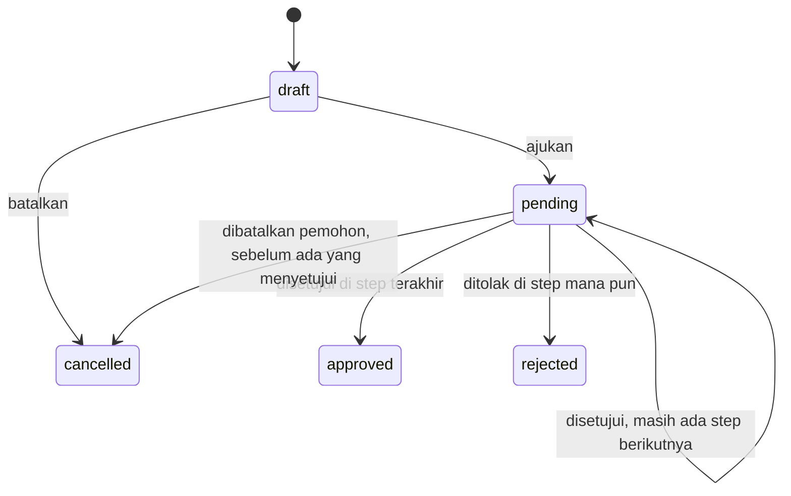

# SIJUAN — Sistem Pengajuan

Aplikasi web untuk mendigitalkan pengajuan administrasi kantor: **cuti**, **reimbursement**, dan **surat keterangan kerja**, dengan approval berjenjang dan riwayat yang tercatat.

Ketiga jenis pengajuan memakai **satu workflow yang sama**. Menambah jenis baru cukup dengan satu baris di `config/approval.php`, satu case enum, dan field form-nya.

Dibangun dengan Laravel 13, Blade, dan Tailwind CSS 4.

## Fitur

| Jenis | Rantai approval | Aturan khusus |
|---|---|---|
| Cuti | Atasan → HR | Hanya hari kerja yang dihitung, tidak boleh bentrok, kuota terpotong saat disetujui |
| Reimbursement | Atasan → Finance | Nota wajib, 6 kategori, batas nominal per kategori, maksimal 30 hari setelah transaksi |
| Surat keterangan kerja | HR | PDF dibuat otomatis setelah disetujui |

- Empat role: Staff, Manager, HR, Finance. Setiap role hanya melihat pengajuan yang relevan baginya.
- Dashboard per role: antrean persetujuan, status pengajuan sendiri, sisa cuti.
- Riwayat setiap pengajuan: siapa melakukan apa, kapan, dan catatannya.
- Rekap bulanan CSV untuk HR dan Finance.

## Alur status



## Hal teknis yang menarik

- **Workflow di satu tempat.** Semua perpindahan status hanya lewat `submit()`, `approve()`, `reject()`, dan `cancel()` di [`app/Models/Submission.php`](app/Models/Submission.php). Controller hanya memanggilnya.
- **Tidak bisa menyetujui pengajuan sendiri.** Dicek di model dan di [`SubmissionPolicy`](app/Policies/SubmissionPolicy.php). Step "manager" hanya bisa diproses atasan langsung pemohon.
- **Aman dari klik ganda dan approval bersamaan.** Setiap aksi berjalan dalam `DB::transaction` dengan `lockForUpdate` pada baris pengajuan. Pemotongan kuota cuti terjadi di transaksi yang sama dengan baris user dikunci; jika kuota tidak cukup, seluruh aksi dibatalkan.
- **Satu sumber kebenaran untuk hak lihat.** Daftar pengajuan dan policy `view` memakai scope `visibleTo` yang sama, termasuk untuk unduh nota.
- **Nota disimpan private.** File ada di `storage/app/private` dan hanya bisa dibuka lewat route yang dijaga policy.
- **Rekap CSV aman dari formula injection.** Sel yang diawali `=`, `+`, `-`, atau `@` dinetralkan sebelum ditulis.

Rancangan lengkap (aturan bisnis BR-01 sampai BR-18, skema database, dan keputusan desain) ada di [`docs/PERANCANGAN.md`](docs/PERANCANGAN.md).

## Menjalankan

Butuh PHP 8.3+, Composer, dan Node.js.

```bash
composer install
cp .env.example .env
php artisan key:generate
php artisan migrate:fresh --seed
npm install
npm run build
php artisan serve
```

Database bawaan adalah SQLite (`database/database.sqlite`), jadi tidak perlu menyiapkan server database.

Jika browser menampilkan halaman dari projek lain di `localhost:8000` (biasanya karena service worker lama), jalankan di port lain: `php artisan serve --port=8123`.

## Akun demo

Dibuat oleh seeder. Kata sandi semua akun: `password`.

| Email | Role | Atasan |
|---|---|---|
| `direktur@sijuan.test` | Manager | tidak ada (step manager dilewati) |
| `manager@sijuan.test` | Manager | Direktur |
| `hr1@sijuan.test`, `hr2@sijuan.test` | HR | tidak ada |
| `finance@sijuan.test` | Finance | tidak ada |
| `staff1@sijuan.test` sampai `staff3@sijuan.test` | Staff | Manager |

Seeder juga membuat enam pengajuan contoh di berbagai status, supaya setiap role langsung punya sesuatu untuk dilihat.

## Test

```bash
php artisan test
```

Feature test di [`tests/Feature/SubmissionWorkflowTest.php`](tests/Feature/SubmissionWorkflowTest.php) menguji aturan bisnis lewat HTTP, sehingga route, policy, validasi, dan workflow teruji sekaligus.

## Deploy (Vercel + Supabase)

Versi online berjalan sebagai container di Vercel (lihat [`Dockerfile.vercel`](Dockerfile.vercel): FrankenPHP dengan Laravel di dalamnya). Karena isi container tidak awet, data disimpan di Supabase: tabel di PostgreSQL, nota di Storage lewat protokol S3. Setiap push ke `main` otomatis ter-deploy.

1. Di Supabase, buat projek, buat bucket privat bernama `nota`, dan buat S3 access key di pengaturan Storage.
2. Salin [`.env.production.example`](.env.production.example) menjadi `.env.production` lalu isi. Untuk `DB_URL`, pakai connection string **Session pooler** dari tombol Connect.
3. Buat kunci aplikasi, lalu tabel dan akun demo, dari komputer sendiri:

   ```bash
   php artisan key:generate --env=production --force
   php artisan migrate --env=production --force --seed
   ```

4. Di Vercel, buat projek dari repo ini dan masukkan isi `.env.production` ke Settings → Environment Variables, lalu deploy ulang.

Migrasi mengaktifkan Row Level Security di semua tabel saat berjalan di PostgreSQL, supaya tabel tidak terbaca lewat Data API Supabase.

## Batasan yang disengaja

- Libur nasional belum dihitung; hari kerja adalah Senin sampai Jumat.
- Akun hanya dibuat lewat seeder; tidak ada registrasi atau halaman manajemen user.
- Satu pengajuan reimbursement hanya memuat satu nota.
- Kuota cuti tidak direset otomatis tiap tahun.
- `lockForUpdate` tidak berefek di SQLite (dipakai saat pengembangan dan test). Perlindungan terhadap approval bersamaan berlaku di versi online yang memakai PostgreSQL.
- Rekap CSV memakai pemisah koma. Excel dengan format regional Indonesia mungkin perlu impor lewat menu Data.
