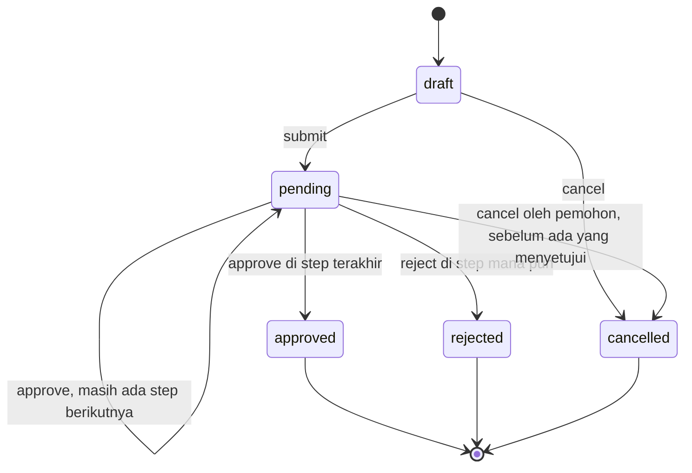
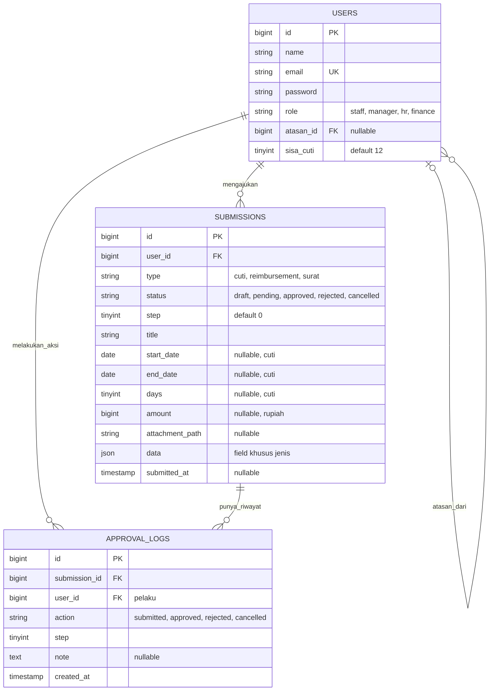

# SIJUAN (Sistem Pengajuan) — Dokumen Perancangan

Sistem digitalisasi pengajuan administrasi kantor (cuti, reimbursement, surat keterangan kerja) dengan approval berjenjang.

> Status: **sudah diimplementasikan**. Dokumen ini adalah rancangan awal; perbedaan antara rancangan dan kode yang dibuat dicatat di bagian 14.

---

## 1. Tujuan

- Menggantikan proses pengajuan lewat kertas/chat dengan satu alur digital yang tercatat.
- Satu workflow approval yang dipakai ulang oleh semua jenis pengajuan.
- Untuk portofolio magang: tunjukkan workflow, policy, transaksi database, dan test, bukan banyaknya teknologi.

## 2. Ruang lingkup

**Masuk (v1):**

| Jenis | Rantai approval | Hasil akhir |
|---|---|---|
| Cuti | atasan → HR | Kuota cuti terpotong |
| Reimbursement | atasan → Finance | Disetujui untuk dibayar (nota wajib) |
| Surat keterangan kerja | HR | PDF bisa diunduh |

Plus: dashboard per role, riwayat approval (audit trail), rekap bulanan CSV.

**Sengaja tidak masuk:** form builder dinamis, designer workflow, UI manajemen user (user dibuat lewat seeder), libur nasional, satu klaim berisi banyak nota (satu pengajuan = satu nota), WebSocket, Redis/queue, multi-perusahaan, REST API, SPA.

## 3. Aktor dan hak akses

| Role | Boleh | Melihat |
|---|---|---|
| `staff` | Membuat, mengedit (draft), mengajukan, membatalkan pengajuan sendiri | Pengajuan sendiri, sisa cuti |
| `manager` | Seperti staff, plus approve/reject pengajuan bawahan langsung (`atasan_id`) | Pengajuan sendiri + milik bawahan |
| `hr` | Approve/reject step `hr` (cuti, surat), unduh rekap | Semua cuti dan surat |
| `finance` | Approve/reject step `finance` (reimbursement), unduh rekap | Semua reimbursement |

Semua role boleh mengajukan untuk dirinya sendiri. Tidak ada role admin; data user berasal dari seeder.

## 4. Alur dan status

Status: `draft`, `pending`, `approved`, `rejected`, `cancelled`.



Rantai approval ditulis di satu file config. Menambah jenis pengajuan = tambah satu baris + satu form.

```php
// config/approval.php
return [
    'cuti'          => ['manager', 'hr'],
    'reimbursement' => ['manager', 'finance'],
    'surat'         => ['hr'],
];
```

`submissions.step` adalah indeks step yang sedang menunggu. Pengajuan selesai ketika `step` melewati langkah terakhir.

## 5. Aturan bisnis

**Umum**

| Kode | Aturan |
|---|---|
| BR-01 | Pemohon tidak boleh approve/reject pengajuannya sendiri. |
| BR-02 | Step `manager` hanya bisa diproses atasan langsung pemohon (`users.atasan_id`). Jika pemohon tidak punya atasan, step `manager` dilewati otomatis saat submit. |
| BR-03 | Step `hr` / `finance` bisa diproses user mana pun dengan role itu, selain pemohon. |
| BR-04 | Reject wajib menyertakan catatan. |
| BR-05 | Pengajuan hanya bisa diedit saat `draft`. |
| BR-06 | Setiap perubahan status ditulis ke `approval_logs` dan tidak pernah diubah/dihapus. |
| BR-07 | Approve/reject memakai lock pada baris `submissions` di dalam transaksi, sehingga klik ganda atau dua approver bersamaan tidak memproses dua kali. |

**Cuti**

| Kode | Aturan |
|---|---|
| BR-08 | Hari cuti = hari Senin–Jumat dari `start_date` sampai `end_date` (inklusif). Libur nasional belum dihitung. |
| BR-09 | `start_date` tidak boleh di masa lalu; `end_date >= start_date`. |
| BR-10 | Tidak boleh bentrok dengan cuti pemohon lain yang berstatus `pending`/`approved`. Dicek saat submit **dan** saat approval final. |
| BR-11 | `days <= sisa_cuti − total hari cuti pending milik pemohon`. Dicek saat submit. |
| BR-12 | Saat approval final, `sisa_cuti` dikurangi `days` di dalam `DB::transaction` dengan `lockForUpdate` pada baris user. Jika sisa tidak cukup, approval gagal dan pengajuan tetap `pending`. |

**Reimbursement**

| Kode | Aturan |
|---|---|
| BR-13 | `amount > 0` dan nota wajib (jpg/png/pdf, maks 2 MB). |
| BR-14 | Nota disimpan di disk private. Hanya pemohon, approver step terkait, dan finance yang boleh mengunduh (policy). |
| BR-15 | `kategori` wajib dan harus salah satu kunci di `config/reimbursement.php`: transportasi, makan_entertain, perjalanan_dinas, komunikasi, perlengkapan_kantor, lainnya. |
| BR-16 | `tanggal_transaksi` wajib, tidak boleh di masa depan, dan pengajuan (submit) maksimal 30 hari setelah tanggal itu. |
| BR-17 | `amount` tidak boleh melebihi batas per kategori di config. Kategori tanpa batas (`null`) tidak dicek. Satu pengajuan = satu nota. |

**Surat keterangan**

| Kode | Aturan |
|---|---|
| BR-18 | Isian: keperluan (teks singkat). Setelah `approved`, pemohon bisa mengunduh PDF yang dibuat saat diminta; nomor surat diturunkan dari id, contoh `SK/2026/000123`. |

Konfigurasi reimbursement (nilai batas hanya contoh, sesuaikan):

```php
// config/reimbursement.php
return [
    'max_hari_pengajuan' => 30,
    'kategori' => [
        // kunci => batas nominal per klaim dalam rupiah (null = tanpa batas)
        'transportasi'        => null,
        'makan_entertain'     => 500_000,
        'perjalanan_dinas'    => null,
        'komunikasi'          => 300_000,
        'perlengkapan_kantor' => 1_000_000,
        'lainnya'             => 500_000,
    ],
];
```

## 6. Model data



Catatan desain:

- Model dinamai `Submission`, **bukan** `Request`, karena bentrok dengan `Illuminate\Http\Request`.
- Kolom yang perlu di-query (tanggal, hari, nominal) dibuat kolom sungguhan dan nullable; sisanya masuk `data` (JSON), termasuk `kategori` dan `tanggal_transaksi` untuk reimbursement. Batasan: laporan lintas field JSON lebih susah di-query; kalau jenis pengajuan makin banyak, pindahkan ke tabel per jenis.
- `type`, `status`, `role` dipetakan ke PHP backed enum (`SubmissionType`, `SubmissionStatus`, `Role`).
- Index: `(type, status)`, `user_id`, `(user_id, start_date, end_date)` untuk cek bentrok.
- Pengajuan tidak dihapus (hanya `cancelled`), supaya audit trail utuh.

**Data seeder (demo):**

| Akun | Role | Atasan |
|---|---|---|
| Direktur | manager | — (step manager dilewati) |
| Manager | manager | Direktur |
| HR 1, HR 2 | hr | — |
| Finance | finance | — |
| Staff 1–3 | staff | Manager |

HR dibuat dua supaya HR yang mengajukan cuti masih punya approver lain (BR-01).

## 7. Halaman dan route

| Route | Fungsi | Akses |
|---|---|---|
| `GET /dashboard` | Ringkasan per role (antrean persetujuan, status pengajuan sendiri, sisa cuti) | semua |
| `GET /submissions` | Daftar + filter jenis/status | semua (dibatasi policy) |
| `GET /submissions/create/{type}` | Form per jenis | semua |
| `POST /submissions` | Simpan sebagai draft | semua |
| `GET /submissions/{id}` | Detail + riwayat approval | pemilik/approver/hr/finance |
| `PUT /submissions/{id}` | Edit draft | pemilik |
| `POST /submissions/{id}/submit` | draft → pending | pemilik |
| `POST /submissions/{id}/approve` | Approve step saat ini | approver step |
| `POST /submissions/{id}/reject` | Reject (catatan wajib) | approver step |
| `POST /submissions/{id}/cancel` | Batalkan | pemilik |
| `GET /submissions/{id}/attachment` | Unduh nota | lihat BR-14 |
| `GET /submissions/{id}/letter` | Unduh PDF surat | pemilik, setelah approved |
| `GET /reports/monthly?month=YYYY-MM` | Rekap CSV | hr, finance |

## 8. Struktur kode

Prinsip: logika workflow ada di **satu tempat** (model `Submission`), bukan tersebar di controller.

```
app/
  Enums/            SubmissionType, SubmissionStatus, Role
  Models/
    Submission.php  submit(), approve(User, ?note), reject(User, note), cancel(User),
                    canBeActedBy(User), chain(), countWorkdays(start, end)
    ApprovalLog.php
    User.php        deductLeave(days), isManagerOf(User)
  Policies/         SubmissionPolicy (view, update, act, cancel, attachment)
  Http/
    Controllers/    SubmissionController, ApprovalController, ReportController, DashboardController
    Requests/       StoreCutiRequest, StoreReimbursementRequest, StoreSuratRequest
config/approval.php       rantai approval per jenis
config/reimbursement.php  kategori, batas nominal, maks hari pengajuan
resources/views/    Blade (Breeze / starter kit)
```

Pola `approve()`:

```
DB::transaction:
  lock baris submission; pastikan status == pending
  pastikan canBeActedBy(user)            // BR-01..03
  tulis approval_log
  step++
  jika step >= count(chain):
      status = approved
      match(type): cuti → cek bentrok lagi + user.deductLeave(days)   // BR-10, BR-12
```

## 9. Tech stack

| Bagian | Pilihan | Alasan |
|---|---|---|
| Framework | Laravel versi stabil terbaru | — |
| Auth | Starter kit resmi paling sederhana (Breeze Blade jika masih tersedia, jika tidak kit Livewire) | Tidak perlu SPA |
| DB dev/test | SQLite (default Laravel) | Nol setup |
| DB deploy | MySQL via Docker Compose (minggu 3) | Lebih dekat ke produksi |
| PDF | `barryvdh/laravel-dompdf` | Satu-satunya dependency tambahan |
| Rekap | CSV via `streamDownload` + `fputcsv` | Bawaan PHP, terbuka di Excel; paket Excel ditambah hanya jika perlu format `.xlsx` |
| Test | PHPUnit (bawaan) | Tanpa tambahan |

Catatan: `lockForUpdate` tidak berefek di SQLite, jadi test concurrency (BR-07, BR-12) hanya bermakna di MySQL. Test logika biasa tetap jalan di SQLite.

## 10. Rencana test (feature test)

1. Staff tidak bisa approve pengajuannya sendiri (BR-01).
2. Manager hanya bisa approve pengajuan bawahannya (BR-02).
3. Alur cuti penuh: manager → hr → `approved`, `sisa_cuti` berkurang (BR-12).
4. Reject tanpa catatan ditolak (BR-04).
5. Cuti bentrok ditolak saat submit (BR-10).
6. Cuti melebihi kuota ditolak saat submit (BR-11).
7. Jumat–Senin dihitung 2 hari kerja (BR-08).
8. Approval final dengan sisa kuota kurang gagal dan status tetap `pending` (BR-12).
9. User tidak terkait tidak bisa mengunduh nota (BR-14).
10. Pemohon tanpa atasan: step manager dilewati (BR-02).
11. Reimbursement melebihi batas nominal kategori ditolak saat submit (BR-17).
12. Reimbursement dengan tanggal transaksi lebih dari 30 hari lalu ditolak saat submit (BR-16).

## 11. Rencana pengerjaan

| Minggu | Isi | Selesai jika |
|---|---|---|
| 0 (sekarang) | Perancangan, skema, seeder dirancang | Dokumen ini disetujui |
| 1 | Auth, role, atasan, **cuti end-to-end** (submit → approve berjenjang → potong kuota → audit log), policy, test 1–8 | Alur cuti jalan dan lulus test |
| 2 | Reimbursement (kategori, batas nominal, upload nota), surat (PDF), dashboard per role, test 9–12 | Tiga jenis jalan dengan satu workflow yang sama |
| 3 | Rekap CSV, Docker Compose + MySQL, deploy, README (screenshot, ERD, penjelasan keputusan teknis) | Ada live demo + README |
| Opsional | Notifikasi email ke approver berikutnya, tabel libur nasional, kalender cuti tim | Hanya jika waktu tersisa |

## 12. Keputusan default (ubah sekarang kalau tidak cocok)

1. **Tidak ada status `paid`.** Approval finance di step terakhir berarti "disetujui untuk dibayar". Lebih sedikit state, alur tetap jelas.
2. **Hari kerja = Senin–Jumat saja**, tanpa libur nasional.
3. **User hanya dari seeder**, tanpa halaman manajemen user.
4. **Rekap pakai CSV**, bukan `.xlsx`.
5. **Kuota cuti 12 hari/tahun**, tanpa reset otomatis tahunan di v1.
6. **Pemohon bisa membatalkan** hanya sebelum ada yang menyetujui; pengajuan ditolak diajukan ulang sebagai pengajuan baru.
7. **Nama projek:** SIJUAN (Sistem Pengajuan).
8. **Reimbursement:** 6 kategori tetap di config, satu nota per klaim, pengajuan maksimal 30 hari setelah transaksi, batas nominal per kategori (BR-15 sampai BR-17).

## 13. Definisi selesai tahap perancangan

- [ ] Ruang lingkup dan keputusan di bagian 12 disetujui.
- [ ] Skema (bagian 6) final.
- [ ] Folder projek dipilih dan repo dibuat.
- [ ] Siap mulai minggu 1.

## 14. Perbedaan implementasi dari rancangan

| Rancangan | Implementasi | Alasan |
|---|---|---|
| Auth dari starter kit (Breeze) | Login dan logout ditulis sendiri di `AuthController` | Akun hanya dari seeder, jadi registrasi, reset password, dan profil dari starter kit tidak terpakai |
| Tiga FormRequest (satu per jenis) | Satu `SubmissionRequest` dengan aturan per jenis | Lebih sedikit file, aturan tetap di satu tempat |
| `days` bertipe tinyint | `days` bertipe smallint | Rentang tanggal panjang bisa melebihi 255 hari kerja sebelum ditolak aturan kuota |
| Aturan bisnis dicek saat simpan dan submit | Bentuk isian dicek saat simpan draft; aturan bisnis (kuota, bentrok, batas nominal, 30 hari) dicek saat submit | Draft boleh belum lengkap benar; yang penting tidak bisa diajukan |
| Minggu 3: Docker Compose, MySQL, deploy | Deploy ke Railway dengan SQLite di volume, tanpa Docker Compose (langkahnya di README) | Railway mengenali Laravel tanpa Dockerfile, dan SQLite cukup untuk demo |
| Seeder memakai `UserFactory` | Seeder memakai `User::create` dan aman dijalankan berulang | Faker adalah dependency dev, jadi factory tidak bisa dipakai di produksi |
| Pesan validasi | Bahasa Indonesia lewat `lang/id/validation.php` (hanya aturan yang dipakai) | Konsisten dengan bahasa antarmuka |

Framework yang terpasang adalah Laravel 13. Jumlah test lebih banyak dari rencana (21 test): selain 12 test di bagian 10, ada test untuk pembatalan, visibilitas draft, alur reimbursement, unduh PDF, rekap CSV, login, dan render semua halaman.
